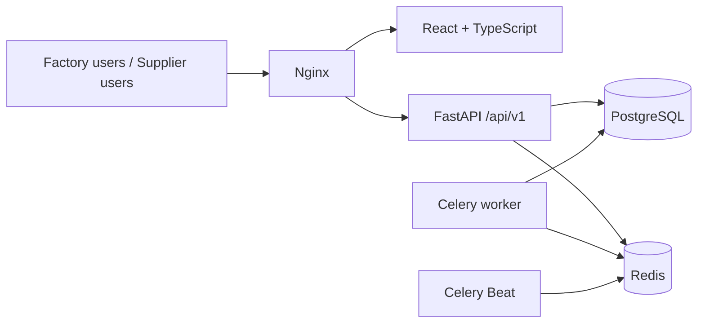

# Architecture

## Overview

FactoryLink is a modular monolith. The web UI calls a versioned FastAPI REST API. The API owns business rules, identity, tenant boundaries and persistence. PostgreSQL stores operational records; Redis brokers scheduled background jobs. Nginx serves the static React build and proxies `/api` and `/health` to the API.

## Runtime containers

| Container | Responsibility |
|---|---|
| `frontend` | Nginx static hosting, reverse proxy and SPA fallback |
| `db` | PostgreSQL database with persistent volume |
| `db-bootstrap` | One-shot creation/rotation of the restricted application database role |
| `migrate` | One-shot Alembic upgrade and optional fictional demo seed using the database owner |
| `redis` | Celery broker/result backend with persistence |
| `backend` | Long-running FastAPI API using the restricted runtime database role |
| `worker` | Celery worker using the restricted runtime database role |
| `scheduler` | Celery Beat, daily schedule using `Asia/Tokyo` |

Only the Nginx port is published to the host. PostgreSQL and Redis remain on the internal Compose network.

## Backend layers

- `app/main.py`: HTTP routing, request/response orchestration and state-transition entry points.
- `app/schemas.py`: Pydantic request validation.
- `app/models.py`: SQLAlchemy persistence model.
- `app/dependencies.py`: bearer token parsing and role authorization.
- `app/security.py`: password hashing and token primitives.
- `app/database.py`: lazy SQLAlchemy engine/session creation.
- `app/seed.py`: fictional Japanese company demo records.
- `app/tasks.py`: background notification work.

## Identity and tenant boundaries

Each user belongs to one organisation. Tokens include user ID, organisation ID and role. Authenticated requests load the user and confirm that the token organisation and role still match the database. Business queries scope records to the authenticated organisation. Supplier queries are restricted through the supplier organisation link. Do not treat an organisation ID sent by a browser as proof of access.

Application authorization and tenant-scoped service queries are reinforced by PostgreSQL RLS on organisation-owned operational tables (migration `0004_postgresql_tenant_rls`). The `organizations`, `users`, and `refresh_tokens` identity tables are intentionally outside those operational policies because registration and authentication need controlled lookups before a tenant transaction is established; their access remains protected by dedicated authentication and application checks. Real-PostgreSQL positive and negative policy tests remain a production prerequisite.

## Localisation and time

- Supported interface locales: Japanese and English.
- Default company timezone and display timezone: `Asia/Tokyo`.
- Server timestamps are stored as UTC-aware values where the schema uses `DateTime(timezone=True)`.
- Business due dates are date-only values; their UI formatting uses Japan locale/timezone.
- Default currency is JPY.
- All interface messages are held in the central message catalog rather than being translated inline in each component.

## Failure and recovery

The API and workers are separate processes. PostgreSQL and Redis use named volumes. Back up the PostgreSQL volume with database-native tools and back up the uploads volume independently. Restore drills are required before production. A worker outage does not stop synchronous API workflows, but scheduled reminders will be delayed.

## PostgreSQL tenant boundary

Operational tables use PostgreSQL `ENABLE ROW LEVEL SECURITY` and `FORCE ROW LEVEL SECURITY` from Alembic migration `0004_postgresql_tenant_rls`. The API derives the current organisation from the signed access token and applies `SET LOCAL app.current_organization_id` on every outer SQLAlchemy transaction. The SQLAlchemy session keeps the tenant ID in `Session.info` and reapplies it after each commit. Supplier sharing is explicitly modelled in policies for `suppliers`, `purchase_orders`, `notifications`, and `attachments`; other operational tables are strictly organisation-owned. These policies provide defence in depth alongside route-level permission checks. They do not replace SQL-injection prevention, least-privilege database roles, or an independent PostgreSQL security review.

## Database privilege separation

The Compose stack runs `db-bootstrap` to create or rotate a non-owner runtime login with `NOSUPERUSER`, `NOCREATEDB`, `NOCREATEROLE`, and no schema ownership. A one-shot `migrate` container connects as the database owner to apply Alembic and optional demo seed. The API and Celery processes connect as the restricted runtime role. Default privileges grant SELECT/INSERT and sequence usage for future application tables; migration `0004` adds only reviewed column-level UPDATE grants to the current runtime role and revokes application DELETE plus writes to `alembic_version`. This keeps schema-management credentials out of long-running application processes.
