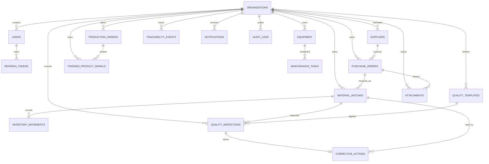

# Database Design

The initial migration creates the SQLAlchemy model metadata. Tables are scoped by `organization_id` for tenant-owned operational data. User credentials and refresh-token records are held separately.

## Entity overview



## Tables

| Table | Purpose | Main integrity rules |
|---|---|---|
| `organizations` | Factory or supplier tenant | Unique organisation code; timezone and currency defaults |
| `users` | Login identity, organisation and role | Unique email; active flag; one tenant per user |
| `refresh_tokens` | Refresh token rotation state | Unique token hash; expiry, revocation and replacement link |
| `suppliers` | Factory supplier directory | Unique `(organization_id, code)`; optional linked supplier tenant |
| `purchase_orders` | Supplier procurement commitments and factory-confirmed cumulative receipt total | Unique `(organization_id, po_number)`; positive quantity; `0 <= received_quantity <= quantity`; linked supplier must belong to the PO-owning factory |
| `material_batches` | Lot-level available/held inventory | Unique `(organization_id, lot_number)`; on-hand and reserved quantities; optional originating purchase order FK |
| `inventory_movements` | Stock ledger | Batch reference, signed quantity, movement type and creator |
| `production_orders` | Work orders, progress and serial-tracking preference | Unique `(organization_id, order_number)`; reservation ledger string; `track_serials` controls serial creation at completion |
| `quality_templates` | Reusable receiving, in-process and final inspection criteria | Unique `(organization_id, code)`; criteria stored as validated JSON definitions |
| `quality_inspections` | Inspection result and applied criterion values | Unique `(organization_id, inspection_number)`; linked optional batch and optional template |
| `corrective_actions` | CAPA case automatically opened for failed inspections | One case per inspection; controlled status lifecycle and required evidence before each stage transition |
| `finished_product_serials` | Finished-unit serial and shipment register | Unique `(organization_id, serial_number)`; links production order, source lots, availability/ship/quarantine state and customer shipment reference |
| `equipment` | Machine register | Unique `(organization_id, code)` |
| `maintenance_tasks` | Scheduled/unplanned maintenance and downtime | Equipment reference; task status, downtime and `PREVENTIVE`/`UNPLANNED` classification |
| `traceability_events` | Chronological lot-level events | Lot identifier and source reference |
| `notifications` | In-app messages | Organisation scope and read state |
| `audit_logs` | Significant business actions | User, entity, action, JSON payload and timestamp |
| `attachments` | Purchase-order documents | Random storage key, bounded file size, optional PO and supplier link |

## Inventory invariants

- Available quantity is `quantity_on_hand - quantity_reserved`.
- A reservation can allocate only batches whose status is `AVAILABLE`.
- Reservation allocations are FIFO by `received_at` and protected with `SELECT ... FOR UPDATE` on PostgreSQL.
- A receipt creates a batch, `RECEIPT` ledger entry and traceability event in one transaction. When linked to a purchase order, the batch stores `purchase_order_id` so the origin can be followed from supplier/PO to lot.
- Cumulative delivered quantities are derived only from `RECEIPT` ledger rows associated with batches for that PO; later consumption and adjustment entries do not change the supplier delivery total.
- Partial receipts are supported; the PO is `PARTIALLY_DELIVERED` until the received total reaches the ordered quantity, then becomes `DELIVERED`. Supplier users can confirm/dispatch but cannot record factory receipt.
- Completing production releases and consumes the recorded reservations; consuming stock creates a negative `CONSUMPTION` ledger entry.
- Cancelling a reserved order releases the reservation without changing on-hand quantity.
- Failed quality inspections place the linked batch on `HOLD`; held stock is excluded from reservations. When a template is applied, numeric limits and PASS/FAIL criteria derive the inspection outcome.
- Each failed inspection creates one `corrective_actions` row. CAPA stages are ordered and evidence-gated: containment, root cause, corrective + preventive action, verification and closure.
- Releasing a held batch is a separate QA/admin action requiring the latest linked inspection to be `PASS`, documented inspection notes and a release reason; the release is audited and traced.
- Completing a serialized production order creates one `finished_product_serials` row for each accepted unit; each row stores the source-lot genealogy needed for reverse traceability and shipment control.
- Serial shipment is blocked when any recorded source lot is on quality hold; the serial is moved to `QUARANTINED` rather than shipped.

## Migration history

- `0001_initial`: initial schema creation.
- `0002_po_receipt_link`: adds the optional PO foreign key to material batches. It uses Alembic batch table recreation on SQLite to support existing local evaluation databases and is conditional for new databases where the updated model metadata already includes the field.
- `0003_refresh_token_families`: groups refresh-token rotations by login session and migrates historical token chains.
- `0004_postgresql_tenant_rls`: enables and forces PostgreSQL RLS on tenant-owned operational tables, adds linked-supplier policies, and narrows runtime database column privileges. This migration is intentionally skipped on SQLite.
- `0006_supplier_receipt_progress`: adds/backfills `purchase_orders.received_quantity` from immutable receipt movements; adds a PostgreSQL trigger that allows changes only in the owning factory tenant context; and tightens linked-supplier PO RLS to correlate the supplier and PO factory. The runtime role receives UPDATE only on this reviewed column in addition to PO workflow fields.
- `0007_quality_capa_serial_traceability`: adds reusable quality templates, inspection criteria snapshots, CAPA cases, finished-product serial genealogy and maintenance classification. New tenant-owned tables receive PostgreSQL FORCE RLS policies; reviewed runtime updates are column-granted. Validate PostgreSQL migrations, RLS and grants using `scripts/db/postgres-acceptance.sh`; SQLite cannot prove RLS or ACL semantics.

## Migration workflow

```bash
cd backend
alembic upgrade head
```

Create future migrations with:

```bash
alembic revision --autogenerate -m "describe change"
```

Review generated migrations before applying them. Never rely on `create_all` to modify an existing production schema.
